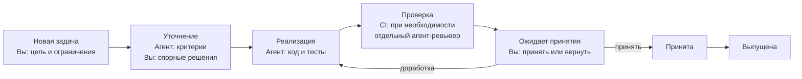
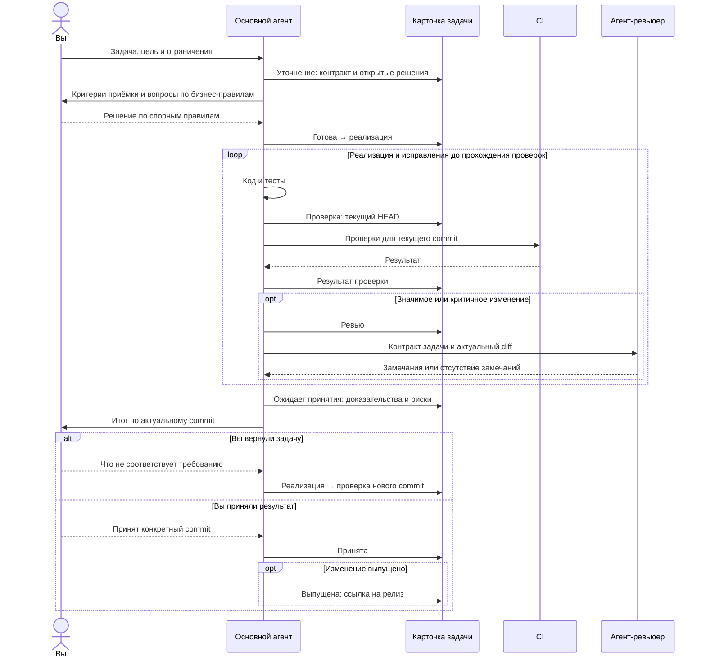

# Схемы процесса для одной задачи

Обе схемы описывают один и тот же процесс. Оркестратора нет: основной агент ведёт задачу, отдельный агент может проверить значимое изменение, а карточка задачи хранит состояние между сессиями.

## Короткая схема

## Подробная схема

Карточка по [шаблону состояния](TASK-STATE.template.md) содержит этап, актуальный commit, подтверждённые проверки, блокер и следующий шаг. Агент сообщает вам о переходах и решениях, которые нужны от вас. Другая сессия начинает с карточки, требования и PR; она сверяет их с текущим HEAD перед продолжением. Если работа остановилась из-за внешней причины, карточка получает статус `блокирована` и конкретное условие возобновления.
